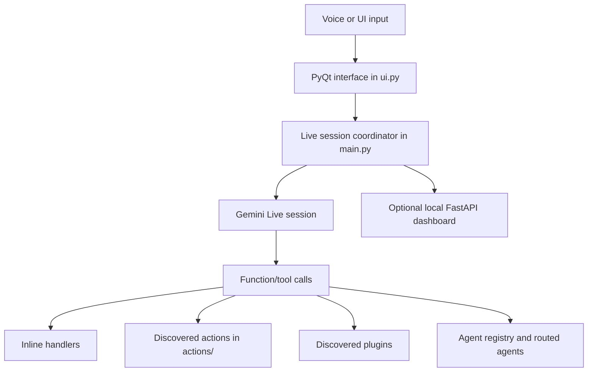

<!--
  ██████╗██╗   ██╗██████╗ ███████╗██████╗ ██████╗ ██╗      █████╗  ██████╗██╗  ██╗
 ██╔════╝╚██╗ ██╔╝██╔══██╗██╔════╝██╔══██╗██╔══██╗██║     ██╔══██╗██╔════╝██║ ██╔╝
 ██║      ╚████╔╝ ██████╔╝█████╗  ██████╔╝██████╔╝██║     ███████║██║     █████╔╝
 ██║       ╚██╔╝  ██╔══██╗██╔══╝  ██╔══██╗██╔══██╗██║     ██╔══██║██║     ██╔═██╗
 ╚██████╗   ██║   ██████╔╝███████╗██║  ██║██████╔╝███████╗██║  ██║╚██████╗██║  ██╗
  ╚═════╝   ╚═╝   ╚═════╝ ╚══════╝╚═╝  ╚═╝╚═════╝ ╚══════╝╚═╝  ╚═╝ ╚═════╝╚═╝  ╚═╝
-->

<div align="center">

```text
 ██████╗██╗   ██╗██████╗ ███████╗██████╗ ██████╗ ██╗      █████╗  ██████╗██╗  ██╗
██╔════╝╚██╗ ██╔╝██╔══██╗██╔════╝██╔══██╗██╔══██╗██║     ██╔══██╗██╔════╝██║ ██╔╝
██║      ╚████╔╝ ██████╔╝█████╗  ██████╔╝██████╔╝██║     ███████║██║     █████╔╝
██║       ╚██╔╝  ██╔══██╗██╔══╝  ██╔══██╗██╔══██╗██║     ██╔══██║██║     ██╔═██╗
╚██████╗   ██║   ██████╔╝███████╗██║  ██║██████╔╝███████╗██║  ██║╚██████╗██║  ██╗
 ╚═════╝   ╚═╝   ╚═════╝ ╚══════╝╚═╝  ╚═╝╚═════╝ ╚══════╝╚═╝  ╚═╝ ╚═════╝╚═╝  ╚═╝
```

**AI-Powered Agent Platform**

[](https://www.python.org/)
[](https://ai.google.dev/)
[](https://riverbankcomputing.com/software/pyqt/)
[](https://github.com/ANONYMOUSworld112/MAX-AGENT)
[](LICENSE)

</div>

---

## Meet MAX — Your AI-Agent Desktop Assistant

> **MAX** *(Multi-Agent eXecution)* is the intelligent runtime that powers CyberBlack's autonomous desktop experience. Built on Google's **Gemini Live API**, MAX listens, understands, and acts — turning natural voice and text commands into real computer actions without writing a single line of code.

MAX brings together a fleet of specialized AI agents across multiple mission-critical clusters — from code generation and DevOps, to browser control, system monitoring, and security enforcement. Everything runs locally on your machine through a sleek PyQt interface, with an optional real-time dashboard for deeper visibility.

Whether you're automating repetitive desktop workflows, delegating software development tasks, or simply asking MAX to manage your calendar and email — it routes your intent through a dual-lane reflex engine, picks the right agent, executes the action, and reports back — all in real time.

<div align="center">

| ⚡ Voice-First | 🤖 Multi-Agent | 🔒 Safety-First | 🖥️ Desktop-Native |
|:---:|:---:|:---:|:---:|
| Gemini Live session | Specialized clusters | Guardrails & kill-switch | Windows · macOS · Linux |

</div>

---

## Quick Start

### Prerequisites

- Python **3.11** or newer
- A working **microphone and audio output** for the live voice interface
- **Windows** is the primary desktop target. Setup code includes platform-specific handling for Windows, macOS, and Linux; individual desktop capabilities vary by platform.

### 1 · Clone and set up

```powershell
git clone https://github.com/ANONYMOUSworld112/MAX-AGENT.git
cd MAX-AGENT
```

### 2 · Setup MAX
```
python setup.py
```

### 3 · Launch MAX

```powershell
python main.py
```

On first launch, the desktop UI prompts for your **Gemini API key** and OS selection. The key is written to `config/api_keys.json` (Git-ignored). **Never commit or share that file.**

---

## Table of Contents

1. [Meet MAX](#meet-max--your-ai-agent-desktop-assistant)
2. [Quick Start](#quick-start)
3. [Executive Overview](#executive-overview)
4. [Complete System Architecture](#complete-system-architecture)
   - [Live Application Flow](#live-application-flow)
   - [Dual-Lane Intent Routing](#dual-lane-intent-routing)
   - [Core Runtime Modules](#core-runtime-modules)
   - [Agent Registry](#agent-registry)
   - [Perception and Verification](#perception-and-verification)
   - [User Interface and Dashboard](#user-interface-and-dashboard)
5. [VJIT · CodeArena](#vjit--codearena)
6. [Safety and Configuration](#safety-and-configuration)
7. [Dependencies and Validation](#dependencies-and-validation)
8. [Repository Map](#repository-map)

---

## Executive Overview

CyberBlack MAX is a Python desktop assistant for voice interaction and computer-based tasks. The current project combines a PyQt interface, a Gemini Live session, dynamically discovered actions and plugins, a registered set of specialized agents, and an optional local dashboard. The repository also contains modular runtime systems for task routing, memory, perception, verification, and tool execution; not every module is used by every entry point.

The primary entry point is `main.py`. It creates the desktop UI, starts a Gemini Live session, registers built-in tools, and routes incoming tool calls to inline handlers, discovered actions, plugins, or agents. The application can also start the local dashboard when its dependencies are available.

`ui.py` contains the PyQt interface and can be launched directly. Other top-level and package modules provide additional components for command handling, scheduling, safety, browser control, memory, and development workflows. Their presence in the repository does not imply that each component is active in the live voice path.

---

## Complete System Architecture

### Live Application Flow



`main.py` builds tool declarations from the inline tools, `actions/*.py` modules, plugins, and registered agents. The action loader expects modules to provide a `TOOL` declaration. The plugin loader scans the `plugins/` directory. The current working tree has no plugin package files, so plugin discovery has no bundled plugin implementation to load by default.

### Dual-Lane Intent Routing

`core/reflex/intent_router.py` defines `ReflexIntentRouter`, which classifies tool calls as a **fast lane** or an **agent-task lane** and selects a target agent. `main.py` uses this router when a tool call does not match an inline handler, discovered action, registered agent, or plugin. The router's lane labels describe routing behaviour; this README makes no latency or performance guarantee.

### Core Runtime Modules

The `core/` package contains several related subsystems:

| Module / Package | Purpose |
|---|---|
| `action_loader.py` | Discovers and dispatches action modules that expose `TOOL` metadata |
| `plugin_loader.py` | Discovers plugin modules and provides their tool declarations |
| `contracts.py`, `events.py`, `hooks.py` | Shared request, result, event, and hook types |
| `reflex/` | Intent routing, triage, and guardrail classes |
| `max_infra/` | Task lifecycle, queue, state database, locks, snapshots, vault, circuit breaker, watchdog, and data-boundary modules |
| `memory/` | Context heap and token-budget utilities |
| `perception/` | Screen capture, accessibility, browser DOM, text detection, UI detection |
| `verification/` | File, process, window, UI element, text, URL, and state-change checks |
| `providers/`, `llm/`, `llm_client.py` | Model provider and client code |
| `coding/`, `adapters/`, `scheduler.py`, `tool_registry.py` | Development, platform, scheduling, and modular-tool components |

These modules have their own APIs. The live `main.py` flow directly uses selected components, including the reflex router and task queue; it does not route every action through every core module.

### Agent Registry

`agents/router.py` defines the default registry and groups agent classes into five clusters:

| Cluster | Registered Agents |
|---|---|
| **Core reasoning** | `MasterOrchestrator`, `DecompositionPlanner`, `ValidationVerifier`, `ModelRouter`, `AdversarialCritic` |
| **Software delivery** | `CodingAgent`, `CodeReviewer`, `TestWriter`, `DevOpsAgent`, `DBAgent`, `APIDesigner`, `DocWriter`, `DependencyMgr` |
| **Productivity** | `EmailAgent`, `CalendarAgent`, `CommsAgent`, `ResearchAgent`, `FileOrganizer`, `NotesAgent`, `TaskTracker`, `MeetingPrep` |
| **Safety and input** | `ComputerUseAgent`, `DesktopAgent`, `BrowserAgent`, `InputArbiter`, `SecurityGate`, `RecoveryEngine` |
| **Infrastructure and health** | `SystemMonitorAgent`, `NetworkAgent`, `BackupAgent`, `UpdateAgent`, `PerformanceAgent`, `HealthCheck` |

Agent tools are added to the live tool declarations by `main.py`; individual integrations still depend on their implementations and configuration.

### Perception and Verification

`core/perception/` contains screen capture, accessibility, browser DOM, text detection, UI detection, and state-building modules. `core/verification/` contains checks for files, processes, windows, UI elements, text, URLs, and state changes. These are repository components; this README does not claim that every action is verified at every level.

### User Interface and Dashboard

- `ui.py` contains the PyQt desktop interface; `ui/components/` contains task-list and task-progress widgets.
- `dashboard/server.py` defines an optional FastAPI server with HTTP and WebSocket routes. `main.py` attempts to start it and disables it if startup fails.
- The dashboard defaults to loopback host `127.0.0.1` on port `8000`. Its pages are `dashboard/static/login.html` and `dashboard/static/app.html`.
- Dashboard requirements include FastAPI, Uvicorn, and cryptography. Upload support depends on `python-multipart`.

> **⚠️ Warning:** Review the server configuration before changing the default host or exposing the dashboard to a network. This README does not claim that the dashboard uses TLS.

---

## VJIT · CodeArena

VJIT is CyberBlack's **live code-typing integration** — a dedicated arena where MAX can write and physically type code directly into any active editor or IDE window on your desktop, character by character, as if a developer were sitting at the keyboard.

### What VJIT Does

When you describe a coding problem, MAX will:

1. **Understand** the problem, constraints, and input/output format from the conversation or whatever is visible on screen.
2. **Generate** a complete solution — initially focused on Java, with the correct class structure and entry point for the target environment.
3. **Locate** the active editor window and confirm the caret is at the correct insertion point before touching anything.
4. **Type** the solution using `computer_control → action: type`, sending real keyboard events into the focused editor — preserving all existing content.
5. **Report** when typing is complete without claiming the code was compiled or tested unless you explicitly asked for that.

> **MAX never clears your editor, changes windows, saves files, runs code, or touches the clipboard unless you ask it to.**

### Skill Definition

The behaviour is declared in [`skills/vjit/SKILL.md`](skills/vjit/SKILL.md) and its keyboard rules in [`skills/vjit/KEYSTROKES.md`](skills/vjit/KEYSTROKES.md). Configuration lives in [`vjit/config.example.yaml`](vjit/config.example.yaml) — the integration is **disabled by default** and does not connect to any external service until explicitly configured.

### Activating VJIT

```text
# In conversation with MAX:
"Solve this Java problem and type the solution into my editor."
"Write a binary search in Java and type it for me."
"I need a solution for this LeetCode problem — type it into VSCode."
```

Ensure your editor is **focused** and the **caret is placed** at the insertion point before asking MAX to type.

---

## Safety and Configuration

### Safety-Related Components

The repository includes safety-related code in:

| File / Package | Behaviour |
|---|---|
| `core/reflex/guardrails.py` | Guardrail enforcement |
| `core/policy.py` | Policy definitions |
| `core/confirm.py` | Confirmation prompts |
| `core/max_infra/kill_switch.py` | Emergency halt |
| `core/max_infra/snapshot.py` | State snapshots |
| `core/max_infra/data_boundary.py` | Data-boundary enforcement |
| `agents/safety/` | Agent-level safety controls |

These implement separate guardrail, confirmation, snapshot, credential, and input-control behaviours. Their presence should not be read as a guarantee that every operation passes through a single enforcement path.

### Configuration and Credentials

| File | Purpose |
|---|---|
| `config/config.yaml` | Structured application defaults |
| `config/api_keys.example.json` | Safe example — commit this, not the real one |
| `config/api_keys.json` | Live keys written by setup UI — **Git-ignored** |
| `config/mcp_servers.yaml` | Currently empty server map |
| `vjit/config.example.yaml` | Disabled by default; no VJIT service integration |

`core.config_loader` supports `.env`, environment values, and legacy JSON. `memory/config_manager.py` includes OS credential-store support, but the live `main.py` key-loading path is a separate direct JSON read.

> **🔴 Caution:** Keep API keys, tokens, user memory, and private institutional data out of Git. Do not paste secrets into issues or documentation.

---

## Dependencies and Validation

`requirements.txt` lists the runtime packages, including PyQt and audio dependencies, `google-genai`, browser automation, desktop-control and image libraries, FastAPI/Uvicorn, and platform-specific Windows packages. `pyproject.toml` configures setuptools as the build backend and requires Python **3.11** or newer.

The GitHub Actions workflow in this checkout builds source and wheel distributions. The current working tree does not contain a `tests/` directory, so this README does not publish a test command, test count, or benchmark pass rate. Evaluation artifacts under `docs/evidence/` are stored records, not proof of results for the current working tree. The report-generation script expects `eval_results_45.json`, which is not present in this checkout.

> **ℹ️ Note:** Package installation, application startup, browser downloads, CI, and tests were not run as part of this README update.

---

## Repository Map

```text
MAX-AGENT/
├── main.py                 # Live voice application coordinator and entry point
├── ui.py                   # PyQt desktop interface
├── setup.py                # Environment setup and setuptools packaging
├── pyproject.toml          # Build-system and package metadata
├── requirements.txt        # Runtime dependency list
├── actions/                # Built-in action handlers
├── agents/                 # Agent classes and registry
├── config/                 # Shared defaults and safe configuration examples
├── core/                   # Shared runtime and infrastructure modules
├── dashboard/              # Optional local FastAPI dashboard
├── docs/evidence/          # Stored evaluation artifacts
├── mcp/                    # MCP client code; no servers enabled by default
├── memory/                 # File-backed memory and configuration helpers
├── scripts/                # Setup, demo, hardware, and report scripts
├── skills/                 # Declarative skills, including VJIT Java typing
├── tools/                  # Manifest-and-handler tool packages
├── ui/components/          # Reusable UI widgets
├── vjit/                   # VJIT-specific documentation and config template
└── workers/                # Calendar, reminder, and media workers
```

See the component guides in the relevant directories for more detail.

---

<div align="center">

Made with ⚡ by **CyberBlack** &nbsp;·&nbsp; Powered by **Google Gemini Live**

</div>
