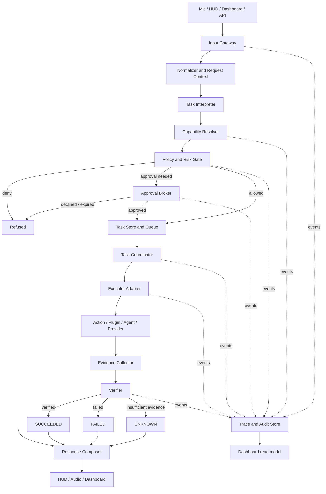

# MAX vNext — End-to-End Architecture and Implementation Plan

**Status:** Under Active Implementation (Phase 0 and Phase 1 completed, 127 automated tests passing). This document describes the target architecture and contracts operationalized in [MAX_AGENT_MASTER_IMPLEMENTATION_PLAN.md](../MAX_AGENT_MASTER_IMPLEMENTATION_PLAN.md) and governed by the Master Engineering Specification v2.

**Scope:** End-to-end target architecture, core contracts, lifecycle state machine, policy gate, and staged execution roadmap. Phase 0 (Forensic Audit & Baseline) and Phase 1 (Foundations: Contracts, State Machine, Clock, Events/Audit, ExecutionGateway, PolicyEngine, Mock Agent Honesty Purge) are fully implemented and verified.

## 1. Architecture goals

MAX vNext should have one auditable route from every input channel to every operation. The model can interpret requests and propose actions, but application code owns tool availability, authorization, approval, execution state, and completion claims.

The architecture must provide:

- One entry pipeline for microphone, HUD text, dashboard, and future API requests.
- Typed task records instead of loose dictionaries and string-only results.
- Capability-based routing with a recorded reason and deterministic policy checks.
- A central permission check (`ExecutionGateway` + `PolicyEngine`) that cannot be bypassed by choosing another tool name.
- Explicit unavailable, draft-only, pending-approval, succeeded, failed, and unknown states.
- Verification tied to the actual effect and the system that owns that effect.
- Persistent task history and structured cryptographic events (`AuditWriter` with SHA-256 hash chaining) that the UI can display.
- Bounded timeouts, concurrency, retries, cancellation, and recovery.
- Tests that run without live services, followed by isolated integration tests for configured providers.

## 2. Target system diagram



## 3. Core contracts (`core/contracts.py`)

Implemented and verified in [`core/contracts.py`](../core/contracts.py) with full JSON round-trip serialization and immutable schemas:

### TaskIntent
- `intent_id`: unique UUIDv4.
- `raw_utterance`: original user request string.
- `action`: target action/capability name.
- `parameters`: validated parameter dictionary.
- `confidence`: float between 0.0 and 1.0.
- `lane`: `LaneType` (`LANE_A` or `LANE_B`).
- `channel`: `ChannelType` (`VOICE`, `HUD`, `DASHBOARD`, `SYSTEM`).
- `timestamp`: UTC ISO timestamp.

### Task
- `id`: unique UUIDv4.
- `intent`: linked `TaskIntent`.
- `status`: `TaskStatus` enum (14 states).
- `priority`: `TaskPriority` (`CRITICAL`, `HIGH`, `NORMAL`, `BACKGROUND`).
- `created_at` / `updated_at`: UTC ISO timestamps.
- `deadline`: optional deadline ISO timestamp.
- `assigned_agent`: canonical name of the assigned agent/executor.
- `blocked_reason`: mandatory string when status is `BLOCKED`.
- `metadata`: domain-specific metadata.

### ActionRequest
- `action_id`: unique UUIDv4.
- `task_id`: parent task UUID.
- `action_name`: canonical registered action.
- `parameters`: action parameters.
- `risk_level`: `RiskLevel` (`LOW`, `MEDIUM`, `HIGH`, `CRITICAL`).
- `timeout_seconds`: execution timeout.
- `channel`: source channel.

### ActionResult
- `action_id` / `task_id`: identifiers matching the request.
- `success`: boolean indicating whether the operation succeeded.
- `output`: primary string output.
- `artifacts`: structured output dictionary.
- `error`: optional error message.
- `verification_status`: `VerificationOutcome` (`VERIFIED`, `FAILED`, `UNKNOWN`, `NOT_APPLICABLE`).
- `execution_time_ms`: duration in milliseconds.

### EventEnvelope
- `id`: unique UUIDv4.
- `event_type`: structured event name (e.g. `action.completed`, `state.transition`).
- `correlation_id` / `parent_event_id`: distributed tracing correlation.
- `timestamp`: UTC ISO timestamp.
- `actor`: originating actor (`user`, `system`, or agent name).
- `payload`: event body dictionary.
- `prev_hash` / `hash`: SHA-256 cryptographic chaining for tamper evidence.

### RoutingDecision
- `task_id`: associated task ID.
- `selected_agent`: chosen executor agent.
- `confidence`: routing confidence.
- `rule_matched`: rule or reason code that drove selection.
- `candidates`: list of candidate agent names evaluated.
- `fallback`: boolean indicating whether fallback was triggered.

## 4. End-to-end request logic

### Step 1 — Input gateway

Keep the microphone stream and Gemini Live audio transport in `main.py`, but reduce `MaxLive` to channel/session responsibilities. HUD and dashboard text must call the same `submit_request(RequestEnvelope)` function rather than sending around the coordinator. Preserve session resumption as conversation state; do not use it as task persistence.

Normalize transcripts and text once: trim controls, validate size, capture channel/timezone, and bind upload IDs to safe file handles. Do not let a model invent a filesystem path to an uploaded file.

### Step 2 — Interpret the user goal

The interpreter may use Gemini to identify intent, required outcome, ambiguity, and candidate capability. The output is a proposal, not authorization. If required fields are missing (recipient, event time, target file, reminder time), ask a clarifying question instead of selecting a plausible default.

Use explicit intent classes:

- `answer`: no side effect; respond from conversation or read-only facts.
- `read`: fetch an observation from an approved source.
- `local_write`: create/change local state.
- `external_write`: send, schedule, book, publish, purchase, or otherwise affect an external system.
- `destructive`: delete, overwrite, shutdown, or irreversible operation.
- `unsupported` / `ambiguous`: no executor call until resolved.

The current `ReflexIntentRouter` may supply a candidate only after it is replaced or verified against these classes. It must not provide a hidden bypass around the capability registry.

### Step 3 — Resolve capabilities

Replace unconditional exposure of all 33 agent tools with a capability registry. The resolver matches the request to capabilities that are `ready`, meet the requested effect, accept the available inputs, and have an appropriate verifier. It returns the selected capability, viable alternatives, and a short reason code such as `exact_capability`, `single_candidate`, `clarification_required`, or `none_available`.

Only expose the selected capability and the small set of relevant, safe alternatives to Gemini for that request. An internal capability ID is authoritative; aliases are normalized once at the registry boundary. If a tool name is unknown or disabled, stop with a typed error. Never reroute arbitrary unknown tool text to another agent.

The agent registry can remain as a catalog of specialized logic. Each agent must either be implemented behind a capability with a real executor/verifier or remain `draft_only` / `disabled`. An agent is not automatically an autonomous delegate. Recursive delegation is out of scope for the first release.

### Step 4 — Apply policy before execution

Use a central `PolicyEngine` for every action, plugin, and agent call. The policy evaluates capability availability, permission class, arguments, target resources, data exposure, risk, user role, and approval requirement. Individual handlers may add stricter checks, but may not loosen central policy.

Suggested policy classes:

| Class | Examples | Default behavior |
|---|---|---|
| `READ_ONLY` | CPU status, search, list files | Allow if capability is configured. |
| `REVERSIBLE_LOCAL_WRITE` | Create a file in an allowed workspace, set a reminder | Allow only with declared resource and rollback or cancellation strategy. |
| `SENSITIVE_LOCAL_WRITE` | Modify an existing project file, change settings | Require a scoped confirmation unless an explicit user policy says otherwise. |
| `EXTERNAL_SIDE_EFFECT` | Send email/message, create calendar event, publish | Require confirmation bound to exact arguments; verify provider receipt/state. |
| `DESTRUCTIVE` | Delete files, shutdown, irreversible changes | Require explicit confirmation, target preview, and action-specific safety checks; deny hard-blocked targets. |
| `UNAVAILABLE` | No provider/adapter, draft-only agent | Do not call an executor; explain the missing capability. |

Approval records are issued by the HUD/dashboard approval broker, not by the model. Bind approval to `task_id`, capability, canonicalized arguments hash, requested effect, expiry, and one-time nonce. If the arguments change, require a new approval. The model cannot approve itself by sending `confirmed=yes`.

### Step 5 — Create and schedule the task

Persist a task before side effects. Use the existing `TaskQueue` and `TaskLifecycleFSM` only after integrating them as the single task-state owner; otherwise remove their production claims. Priority aging should affect queued eligible tasks, not jump past approval or policy checks.

Start with a bounded worker pool. Serialize tasks that share a declared resource key (same file, same calendar, same desktop session); allow independent read-only tasks to run concurrently. Use stable idempotency keys for provider calls that support them. Store leases/heartbeats if work survives process restarts.

### Step 6 — Execute through adapters

Create a common `ExecutorAdapter.execute(task, context)` protocol and concrete adapters for:

- Existing discovered actions in `actions/`.
- Plugins in `plugins/`.
- Simple deterministic local agents.
- External providers such as email and calendar, only after configuration and authorization.
- Desktop automation, only when an observation/input provider is configured.

Adapters receive only the minimum context, scoped permissions, allowed paths/resources, deadline, and cancellation token. Do not pass all memory or all tools to every executor. Preserve provider error codes and distinguish `not_configured`, `rejected`, `timeout_before_send`, and `outcome_uncertain`.

For filesystem changes, canonicalize paths, require them to be under configured workspace roots, reject traversal and disallowed symlink escapes, declare targets before execution, and snapshot before write. Snapshots must cover the exact targets and rollback must itself be verified.

### Step 7 — Collect evidence and verify

Each ready capability must name a verifier. A verifier returns `SUCCESS`, `FAILURE`, or `UNKNOWN`; missing evidence is `UNKNOWN`, never an implicit pass.

Examples:

- File creation: file exists under allowed root and content hash matches the intended artifact.
- Command/test execution: actual process exit code plus captured output; a missing code is unknown.
- Reminder: host scheduler registration exists and has the requested time/message.
- Email: provider receipt/message ID and, if needed, sent-folder lookup.
- Calendar: provider event ID and read-back of time/title.
- Desktop action: observed window/UI state before and after, tied to the requested target.
- Health check: probe each subsystem; every unprobed component remains unknown.
- Web search: successful backend result with source/time metadata; empty/error responses are failures, not answers.

`ValidationVerifier` should remain a narrow verifier or be renamed. It cannot claim semantic quality from only an exit code. `VerificationEngine` aggregates named evidence, but only task-specific required checks can turn the task into `SUCCEEDED`.

### Step 8 — Complete, fail, or recover

Use these terminal statuses:

- `SUCCEEDED`: every required verification check passed.
- `FAILED`: an executor or required verifier confirmed failure.
- `UNKNOWN`: side effect may have happened, but evidence is insufficient.
- `CANCELLED`: no further work is running; report any partial side effects.
- `DENIED`: policy or approval rejected the operation.

Retry only idempotent operations or operations whose prior outcome is known not to have occurred. A timeout after an external send is `UNKNOWN`; query the provider before retrying. Roll back local work on failure only when rollback is safe and then verify the rollback. Emit retry/recovery events and cap attempts.

### Step 9 — Respond to the user

The response composer receives the task status and verified evidence, not just an executor string. It may explain in natural language, but it must preserve the state:

- Success: say what was done and cite the observed evidence in plain terms.
- Draft-only: label it a draft and say where it exists (or that it exists only in memory).
- Needs approval: show the exact operation and wait; do not say it is done.
- Unavailable: state which integration is not configured.
- Failure/unknown: say what failed or remains unverified, and whether a retry is safe.

Pass structured task status back through the function response so Gemini cannot lose `status`, `error`, or evidence details. Keep artifacts machine-readable and exclude secrets.

## 5. Task state machine (`core/state_machine.py`)

Implemented and verified in [`core/state_machine.py`](../core/state_machine.py) according to Master Engineering Specification v2 Section 8:

```text
               ┌─────────────┐
               │   CREATED   │
               └──────┬──────┘
                      │
               ┌──────▼──────┐
               │   PLANNED   │
               └──────┬──────┘
                      │
               ┌──────▼──────┐
        ┌─────►│   QUEUED    │◄────┐
        │      └──────┬──────┘     │
        │             │            │ (resume/retry)
        │      ┌──────▼──────┐     │
        ├─────►│   RUNNING   ├─────┤
        │      └──────┬──────┘     │
(unblock)             │            │
        │      ┌──────▼──────┐     │
        │      │  VERIFYING  │     │
        │      └──────┬──────┘     │
        │             │            │
   ┌────┴────┐ ┌──────▼──────┐ ┌───┴────┐
   │ BLOCKED │ │  RETRYING   │ │ PAUSED │
   └─────────┘ └─────────────┘ └────────┘

Terminal States:
  COMPLETED     (Verified success)
  FAILED        (Terminal execution or verification failure)
  CANCELLED     (Explicitly aborted by user or policy)
  EXPIRED       (TTL or deadline exceeded while queued)
  INTERRUPTED   (Killed by emergency stop / KillSwitch)
```

Transitions are strictly validated against an explicit legal transition table. Terminal states reject any further transitions. Transitioning to `BLOCKED` requires an explicit `blocked_reason`. Every transition is recorded with timestamp and actor in thread-safe transition history.

## 6. Persistence and observability (`core/events.py` & `core/max_infra/state_db.py`)

Implemented and verified in [`core/events.py`](../core/events.py) and [`core/max_infra/state_db.py`](../core/max_infra/state_db.py):

- **EventBus:** In-memory publish/subscribe event bus with backpressure and subscriber exception isolation.
- **AuditWriter:** Append-only, SHA-256 hash-chained tamper-evident event log. Every event hash is linked to its predecessor (`prev_hash`), ensuring deletions, re-orderings, or tampering are mathematically detectable.
- **StateDB Integration:** Audit events are persisted directly into the SQLite WAL `audit_log` table with timestamps, actor, event types, payloads, and cryptographic hashes.

The HUD and dashboard subscribe to the `EventBus` stream. They display task status, current stage, confirmation requests, verified evidence, errors/retries, and execution timelines.

## 7. Security and data boundaries

- Central execution choke point (`core/gateway.py`) intercepts all actions with timeout and confirmation enforcement.
- Deterministic policy classification (`core/policy.py`) categorizes operations into 4 risk tiers (`LOW`, `MEDIUM`, `HIGH`, `CRITICAL`) with confirmation requirements determined by channel trust.
- Banned-import AST scanner (`tests/test_banned_imports.py`) detects unchoked OS primitives (`subprocess`, `pyautogui`, `ctypes.windll`, `shutil.rmtree`) outside of approved adapters.
- Emergency KillSwitch immediately revokes physical inputs and trips state transitions.

## 8. Mapping to the repository

| Component | Location | Implementation Status |
|:---|:---|:---|
| **Data Contracts** | `core/contracts.py` | ✅ Complete (Task 1.1) — `TaskIntent`, `Task`, `ActionRequest`, `ActionResult`, `EventEnvelope`, `RoutingDecision` |
| **State Machine** | `core/state_machine.py` | ✅ Complete (Task 1.2) — 14-state lifecycle with explicit transition table |
| **Injectable Clock** | `core/clock.py` | ✅ Complete (Task 1.3) — `SystemClock`, `FakeClock` protocol |
| **Events & Audit** | `core/events.py`, `core/max_infra/state_db.py` | ✅ Complete (Task 1.4) — `EventBus` pub/sub, SHA-256 `AuditWriter`, SQLite `audit_log` |
| **Execution Gateway** | `core/gateway.py` | ✅ Complete (Task 1.5) — Single choke point for all side effects |
| **Policy Engine** | `core/policy.py` | ✅ Complete (Task 1.5) — Risk tiers, channel trust, confirmation matrix |
| **Import Scanner** | `tests/test_banned_imports.py` | ✅ Complete (Task 1.6) — AST scanner enforcing adapter boundary |
| **Mock Agents** | `agents/` (all 33 agents) | ✅ Complete (Task 1.7) — Fake success purged; raise `NotImplementedError` |
| **Capability Registry** | `core/capability_registry.py` | ✅ Complete (Task 2.1) — Parameter schemas, resources, idempotency, risk, verifiers (14 tests) |
| **Intent Engine** | `core/intent_engine.py`, `core/plan_validator.py` | ✅ Complete (Task 2.2) — Fast-path parsing & compound DAG decomposition; 100% golden route accuracy (13 tests) |
| **Deterministic Router** | `agents/router.py` | ✅ Complete (Task 2.3) — 5-step routing pipeline, circuit breaker fallback, RoutingDecision audit emission (9 tests) |
| **Task Graph** | `core/task_graph.py` | ✅ Complete (Task 2.4) — DAG data structure with topological execution, cycle detection, budget checks (10 tests) |
| **Desktop Automation** | `actions/desktop.py`, `core/adapters/` | ✅ Complete (Phase 3) — `exec()` RCE eliminated, WindowsDesktopAdapter + UIA semantic targeting, ApplicationRegistry + L3 verification, UserActivityMonitor (21 tests) |
| **Coding Workflow** | `core/coding/`, `agents/software/coding_agent.py` | ✅ Complete (Phase 4) — `CodingExecutor` protocol, `WorktreeSandbox`, `LocalDevWorker`, independent `TestVerifier` (12 tests) |
| **Deterministic Scheduler** | `core/scheduler.py` | ✅ Complete (Phase 5) — Priority aging, RFC 5545 RRULE recurrence, restart recovery, TaskGraph parallel dispatch, Dijkstra sorted resource leases (20 tests) |
| **Memory Hardening** | `memory/memory_manager.py`, `core/context_engine.py` | ✅ Complete (Phase 6) — Provenance-gated writes (TRUSTED/UNTRUSTED), token-budgeted ContextEngine, SQLite StateDB memory_layers (11 tests) |
| **Host Execution** | `core/process_manager.py` | 🔄 Phase 7 — Sandboxed process tree management & audit |
| **Verification Engine** | `core/verification/` | ⏳ Phase 8 — Multi-method verification & self-correction |

## 9. Ten daily-life acceptance scenarios

These scenarios become end-to-end tests with fake adapters first. Later, each configured provider gets isolated integration tests.

| Request | Route and policy | Required evidence | Required final behavior |
|---|---|---|---|
| “What is my CPU usage?” | Read-only system-status capability. | Successful local metric sample and timestamp. | Report observed metric; report unavailable if the probe fails. |
| “What is the weather today?” | Current-information capability; no cached guess. | Successful weather source response and observation time. | Cite the returned source/result or state lookup failed. |
| “Remind me to call Mom tomorrow at 6.” | Parse using user timezone; clarify if date/time ambiguous; local scheduler write. | Scheduler job ID and read-back of scheduled time/message. | Say reminder set only after scheduler confirmation. |
| “Create a grocery-list file.” | Local file capability; resolve allowed workspace destination; clarify target if needed. | Exact file path, content hash, and successful read-back. | Report created file and location. |
| “Schedule a dentist visit for Friday at 2.” | Calendar external-write capability; require calendar config and scoped approval. | Provider event ID and read-back of title/time/timezone. | Do not claim scheduled without provider confirmation. |
| “Send this note to Alex.” | Resolve recipient; show exact message; require send approval. | Provider message ID or confirmed send-folder record. | Distinguish draft, pending approval, sent, failed, and unknown. |
| “Click Save in my editor.” | Desktop capability only if observer and input adapter are ready; approval per policy. | Target observed before action and saved-state evidence after. | Otherwise report desktop automation unavailable; do not simulate success. |
| “Open Calculator.” | Desktop app-launch capability. | Process/window observation matching Calculator. | Say opened only after observation; otherwise report failure. |
| “Check whether my photos were backed up.” | Read-only backup status capability. | Backup provider status plus timestamp/items checked. | Unknown if no authoritative backup evidence; never infer from local file existence. |
| “Delete all duplicate photos.” | Destructive file operation; preview exact candidate list; explicit approval; snapshot/rollback plan. | Before/after file manifest and verified deletion/rollback. | No deletion before approval; report exact count and paths only after verification. |

## 10. Implementation phases and gates

The implementation follows the 13 gated phases specified in [MAX_AGENT_MASTER_IMPLEMENTATION_PLAN.md](../MAX_AGENT_MASTER_IMPLEMENTATION_PLAN.md):

- **Phase 0 — Forensic Audit & Baseline:** ✅ Complete. 18 audit docs, 6 evolution benchmarks, 25-task baseline evaluation, 21 characterization tests.
- **Phase 1 — Foundations:** ✅ Complete. Contracts, 14-state machine, clock, events/audit, gateway, policy, banned imports test, mock agent purge. 127 tests passing.
- **Phase 2 — Task Planning & Agent Routing:** ✅ Complete. `CapabilityRegistry`, `IntentEngine`, deterministic `AgentRouter`, `TaskGraph`. 173 tests passing. 100% route accuracy on golden benchmark.
- **Phase 3 — Desktop Automation:** ✅ Complete. `exec()` RCE eliminated, `WindowsDesktopAdapter` with UIA semantic targeting, `FakeDesktopAdapter` test double, `ApplicationRegistry` with L3 post-launch verification, `UserActivityMonitor`. 194 tests passing.
- **Phase 4 — Coding Workflow:** ✅ Complete. `CodingExecutor` protocol, `WorktreeSandbox` isolation, `LocalDevWorker`, independent `TestVerifier` with weakening detection, `actions/dev_agent.py` deprecated. 206 tests passing.
- **Phase 5 — Scheduler & Resource Leases:** ✅ Complete. `TaskScheduler` with SQLite WAL persistence, injectable Clock, RFC 5545 recurrence engine, priority aging, DST handling, misfire policies, `LockManager` shared/exclusive resource leases, and concurrent `TaskGraphDispatcher`. 226 tests passing.
- **Phase 6 — Memory & Context Hardening:** ✅ Complete. Provenance gating preventing memory poisoning, task-scoped `ContextEngine` with token budget enforcement, non-destructive SQLite `StateDB` migration and indexed queries. 237 tests passing.
- **Phase 7 — ProcessManager & Security:** 🔄 Next. Sandboxed process tree, credential protection, network isolation.
- **Phase 8 — Verification Engine:** Multi-method verification, self-correction, failure recovery.
- **Phase 9 — Provider Abstraction:** Local ONNX / cloud model routing, offline resilience.
- **Phase 10 — Advanced Capabilities:** RSVP speed reader, voice streaming, browser automation.
- **Phase 11 — Observability & Dashboard:** Real-time HUD progress widget, authenticated API.
- **Phase 12 — Final Acceptance:** Full 25-task golden benchmark re-test, ≥80% verified success rate.

## 11. Definition of done

MAX vNext is ready for a capability only when:

1. It has a documented input schema, availability state, permission class, timeout, and verifier.
2. All request channels use the same policy and coordinator path.
3. Approval, cancellation, idempotency, and partial-failure behavior are tested where applicable.
4. Success depends on required evidence, not agent prose or a default field.
5. The user-facing response matches the persisted task state.
6. Logs and memory do not expose credentials or unnecessary sensitive content.
7. Offline tests pass, and live integration tests are scoped to a controlled provider/device.

Do not describe the system as a fully verified agent swarm until these gates are true for the capabilities advertised to users.
